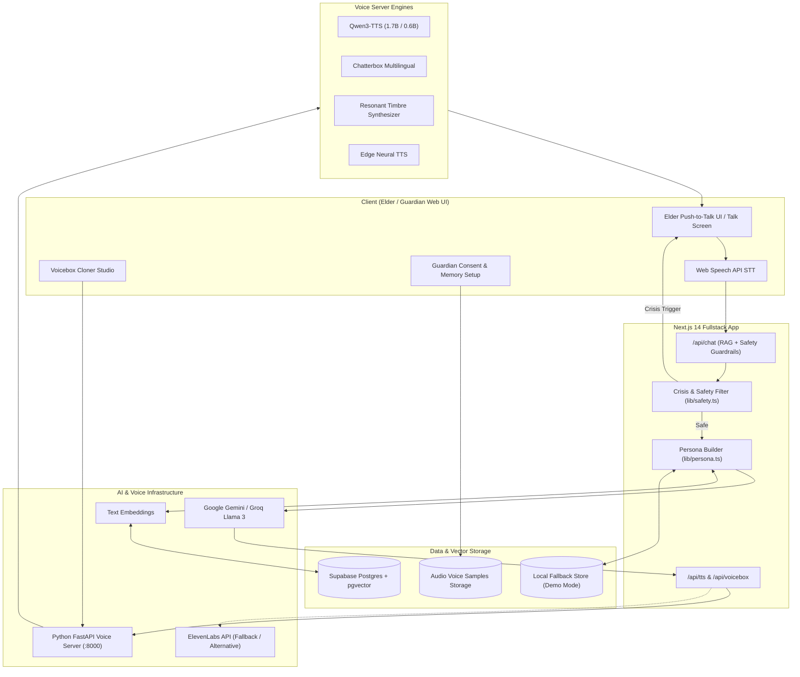

<div align="center">

# 🎙️ VOICE-CLONER & Smriti (स्मृति)
### Zero-Shot Neural Voice Cloning & Compassionate Voice Memory Companion for Elders

[](https://nextjs.org/)
[](https://www.typescriptlang.org/)
[](https://fastapi.tiangolo.com/)
[](https://tailwindcss.com/)
[](./SAFETY_AND_ETHICS.md)

<p align="center">
  <strong>Zero-shot voice cloning and memory-grounded AI companion built to bring solace to grieving elders through familiar voices, safeguarded by strict ethical, transparency, and crisis protocols.</strong>
</p>

[Key Features](#-key-features) •
[Architecture](#-system-architecture) •
[Voice Engines](#-multi-engine-voice-cloning-stack) •
[Quickstart](#-quickstart-guide) •
[Safety & Ethics](#-safety-ethics--guardrails) •
[Evaluation Suite](#-built-in-evaluation-test-suite)

---

</div>

## 🌟 Overview

**VOICE-CLONER (Smriti / स्मृति)** bridges state-of-the-art neural voice cloning with compassionate, memory-grounded conversational AI. Designed specifically for older adults experiencing profound loneliness or grief, it allows them to converse naturally using a familiar loved one's voice, reconstructed from authentic voice samples and verified family memories.

> ⚠️ **Ethics First:** This is an academic research prototype. The system strictly identifies itself as an **AI simulation** at all times, requires explicit family consent, enforces session duration limits (to prevent unhealthy emotional dependency), and features real-time crisis intervention.

---

## ✨ Key Features

- 🎙️ **Zero-Shot Neural Voice Cloning:** Clone distinct timbre, cadence, and vocal warmth from as little as 30–60 seconds of reference audio.
- 🗣️ **Multi-Engine Audio Synthesis:** Supports Qwen3-TTS, Chatterbox Multilingual, Voicebox Resonant Timbre Synthesizer, ElevenLabs, and Edge Neural TTS.
- 👵 **Elder-Centric Interface:** High-contrast layout, large typography, push-to-talk single-button interaction, and live audio waveform feedback.
- 🧠 **RAG Memory Grounding:** Conversational memories indexed via embeddings and vector search (pgvector / local fallback) to ensure the AI speaks only of real shared events without hallucination.
- 🛡️ **Comprehensive Safety Guardrails:**
  - Automated crisis/self-harm detection with instant helpline routing (988 / AASRA).
  - Explicit refusal of financial, legal, medical, or property advice.
  - Transparent "AI Simulation" watermark banner visible on every interaction.
  - 20-minute session duration soft nudges to prevent emotional over-reliance.
- 🔒 **One-Click Complete Data Erasure:** Full right-to-be-forgotten implementation that wipes persona, memories, voice samples, and chat transcripts instantly.

---

## 🏛️ System Architecture



---

## 🎛️ Multi-Engine Voice Cloning Stack

| Engine | Characteristics | Target Use-Case | Latency |
| :--- | :--- | :--- | :--- |
| **Qwen3-TTS (1.7B / 0.6B)** | Zero-shot cloning with natural language delivery control (`instruct`) | High-fidelity voice reproduction with emotional nuance (GPU/Colab) | ~2–4s (GPU) |
| **Chatterbox Multilingual** | 23-language zero-shot cloning with paralinguistic tags (`[laugh]`, `[sigh]`) | Multilingual and expressive conversational speech | ~3–5s (GPU) |
| **Voicebox Timbre Synthesizer** | Acoustic timbre matching matching fundamental pitch & harmonics | Instant local synthesis on any machine without high-end GPU | <500ms (CPU) |
| **ElevenLabs Voice Cloning** | Professional cloud-hosted instant voice cloning & voice design | Production-grade fidelity fallback | ~1–2s (Cloud) |
| **Edge Neural TTS** | Ultra-reliable neural speech synthesis across diverse voice profiles | Fast offline/lightweight baseline | <300ms |

---

## 📂 Project Structure

```
VOICE-CLONER/
├── app/                              # Next.js 14 App Router
│   ├── (elder)/talk/                 # Push-to-talk elder companion interface
│   ├── voice-cloner/                 # Voicebox multi-engine cloning studio
│   ├── onboarding/                   # Guardian consent checklist & voice upload
│   ├── dashboard/                    # Safety oversight, transcripts & memory controls
│   ├── test-suite/                   # Live 7-point PRD evaluation test runner
│   ├── api/                          # Backend API Route Handlers
│   │   ├── chat/route.ts             # RAG memory retrieval + LLM + safety filtering
│   │   ├── tts/route.ts              # TTS coordinator (Local voice server / ElevenLabs)
│   │   ├── voicebox/route.ts         # Voicebox speaker profile & synthesis bridge
│   │   ├── clone-voice/route.ts      # Audio reference ingestion & profile creation
│   │   ├── memories/route.ts         # Memory management & vector indexing
│   │   └── delete-all/route.ts       # One-click complete data purge
│   ├── layout.tsx                    # Root application layout & responsive navbar
│   └── page.tsx                      # Landing & showcase homepage
├── components/                       # Shared UI components & audio visualizers
├── lib/                              # Core application libraries
│   ├── safety.ts                     # Crisis detection, helpline logic & safety filters
│   ├── persona.ts                    # System prompt constructor with guardrails
│   ├── embeddings.ts                 # Vector embedding generators
│   ├── storage.ts                    # Supabase + local demo storage abstraction
│   └── supabase.ts                   # Supabase client initializer
├── voice-server/                     # Python Voicebox & Zero-Shot Cloning Server
│   ├── main.py                       # FastAPI application & audio processing pipeline
│   ├── voicebox_colab_runner.py      # Google Colab GPU runner with Cloudflare Tunnel
│   ├── requirements.txt              # Python server dependencies
│   └── storage/                      # Speaker reference profiles & audio cache
├── docs/                             # Engineering & Ethical Documentation
│   ├── ARCHITECTURE.md               # Detailed architectural specification
│   ├── PRD.md                        # Product Requirements Document
│   └── SAFETY_AND_ETHICS.md          # Ethics, consent, and safety manifesto
├── supabase/
│   └── schema.sql                    # Postgres schema with pgvector indexes
├── .env.local.example                # Template for environment configuration
├── package.json                      # Node.js dependencies
└── tsconfig.json                     # TypeScript compiler configuration
```

---

## 🚀 Quickstart Guide

### Prerequisites
- **Node.js:** v18.0.0 or later (v20+ recommended)
- **Python:** 3.10, 3.11, 3.12, or 3.13
- **Git**

### 1. Clone & Install Dependencies

```bash
git clone https://github.com/sayandeep0212/VOICE-CLONER.git
cd VOICE-CLONER

# Install Node.js frontend dependencies
npm install
```

### 2. Configure Environment Variables

Copy the example environment file:
```bash
cp .env.local.example .env.local
```

Configure your credentials inside `.env.local`:
```env
# Optional Supabase (Leave blank to use built-in local demo storage)
NEXT_PUBLIC_SUPABASE_URL=
NEXT_PUBLIC_SUPABASE_ANON_KEY=
SUPABASE_SERVICE_ROLE_KEY=

# LLM Providers (Provide at least one)
GEMINI_API_KEY=your_gemini_api_key
GROQ_API_KEY=your_groq_api_key

# Voice Cloning & TTS
ELEVENLABS_API_KEY=your_elevenlabs_key
VOICE_SERVER_URL=http://localhost:8000
VOICE_SERVER_SECRET=smriti-dev-secret-2025

# Enable local demo storage and default test persona
NEXT_PUBLIC_DEMO_MODE=true
```

### 3. Start the Voice Server (Python)

```bash
cd voice-server
pip install -r requirements.txt
python main.py
```
> The voice server will start at `http://localhost:8000`. Test health via `http://localhost:8000/health`.

#### ⚡ Option: Free Google Colab GPU
To run high-fidelity models (Qwen3-TTS / Chatterbox) on free T4/A100 GPUs:
1. Open [Google Colab](https://colab.research.google.com).
2. Upload `voice-server/main.py` and `voice-server/voicebox_colab_runner.py`.
3. Set hardware accelerator to **T4 GPU** and run:
   ```python
   !python voicebox_colab_runner.py
   ```
4. Copy the generated Cloudflare tunnel URL (e.g., `https://xyz.trycloudflare.com`) into your `.env.local` as `VOICE_SERVER_URL`.

### 4. Start the Next.js Frontend

In the root directory:
```bash
npm run dev
```
Open **[http://localhost:3000](http://localhost:3000)** in your browser (Google Chrome is recommended for native Web Speech API support).

---

## 🧪 Built-in Evaluation Test Suite

The project includes an automated live evaluation test suite at `/test-suite`. It tests all 7 critical PRD requirements directly in your browser:

1. **Crisis Intervention & Helpline Trigger:** Detects grief/crisis statements and immediately triggers safety hotlines (e.g., 988, AASRA).
2. **AI Identity Transparency:** Verifies that when directly questioned (*"Are you real?"*), the AI never pretends to be the living or resurrected person.
3. **Financial / Property Refusal:** Ensures the AI refuses requests involving wills, inheritance, or banking.
4. **RAG Memory Grounding:** Rejects questions about unrecorded memories rather than inventing false facts.
5. **Consent Gate:** Confirms voice cloning cannot proceed without explicit guardian and estate consent.
6. **Data Erasure (Right to be Forgotten):** Validates one-click complete deletion across all storage tiers.
7. **Session Limit Soft Nudge:** Prompts healthy disengagement after 20 minutes of continuous conversation.

Run the test suite anytime at `http://localhost:3000/test-suite`.

---

## 🛡️ Safety, Ethics & Guardrails

Voice cloning of deceased relatives involves profound emotional sensitivity. This project enforces strict ethical tenets:
- **Never Deceive:** The elder is gently reminded this is a cherished digital memory companion, not the actual living person.
- **Active Crisis Guardrails:** Immediate override of the persona if self-harm or deep psychological distress is expressed.
- **Non-Commercial:** The models and research implementations are strictly for educational and humanitarian exploration.
- **Zero Lock-In:** Guardians can export or permanently delete all data at any moment with one click.

For the complete ethical framework, see [SAFETY_AND_ETHICS.md](./SAFETY_AND_ETHICS.md).

---

## 📄 License & Attribution

- **License:** Non-Commercial Educational Research License.
- **XTTS-v2 & Voicebox:** Licensed under Coqui / Voicebox research terms.
- Built with ❤️ for families seeking solace, remembrance, and comfort.
